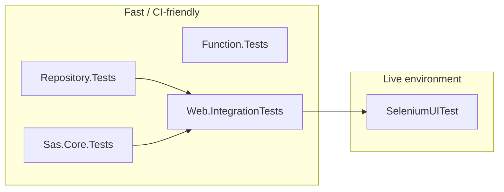
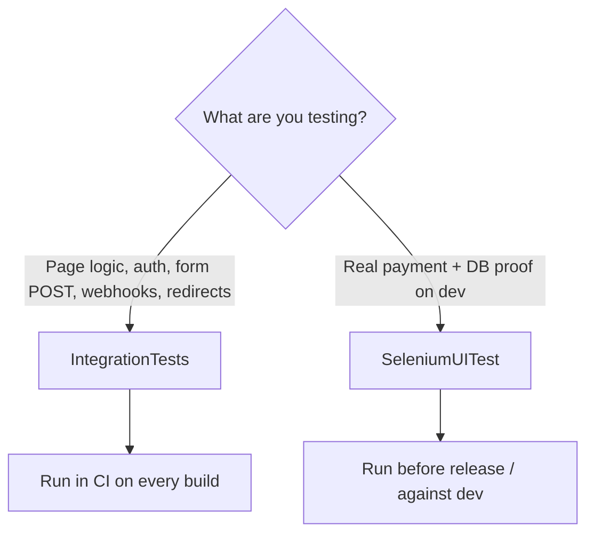

# Test projects overview

This solution uses several test projects at different layers: fast unit tests near the data layer, integration tests through the real ASP.NET pipeline, and browser tests against isolated localhost or the developer environment.

## At a glance

| Project | Type | Focus | Approx. tests |
|---------|------|--------|---------------|
| `BancoAlimentar.AlimentaEstaIdeia.Repository.Tests` | Unit | Data access and repository business rules | 272 |
| `BancoAlimentar.AlimentaEstaIdeia.Sas.Core.Tests` | Unit | Multi-tenant core, payment builders, middleware | ~13 |
| `BancoAlimentar.AlimentaEstaIdeia.Function.Tests` | Unit | Azure Functions (subscriptions, multibanco reminders) | 49 |
| `BancoAlimentar.AlimentaEstaldeia.Web.IntegrationTests` | Integration | Full web app via in-memory test host and isolated capture fixtures | 301 |
| `BancoAlimentar.AlimentaEstaIdeia.Web.SeleniumUITest` | UI + offline helpers | Real browser against **local/dev** + DB verification | 67 browser + 109 offline |

**Supporting projects (not test runners):**

- `BancoAlimentar.AlimentaEstaIdeia.Web.TestHost` — `CustomWebApplicationFactory`, seeders, auth helpers (`IdentityAuthTestHelper`), tracked `StubMail` for integration tests
- `BancoAlimentar.AlimentaEstaIdeia.Testing.Common` — HTML form helpers, test Key Vault stub

## How the layers relate



- **Repository** — rules and persistence
- **Sas.Core** — tenant and payment infrastructure
- **Function** — background jobs (subscriptions, payment reminders)
- **Integration** — pages, auth, forms, webhooks, routing
- **Selenium** — real payment flows on dev/staging with SQL verification

---

## Web test projects compared

Integration and Selenium both exercise the **web app from the outside**, but they differ in **how the app runs**, **what they stub**, and **how deep they go into real payments**.

### Quick comparison

| | **Web.IntegrationTests** | **Web.SeleniumUITest** |
|---|--------------------------|-------------------------|
| **What it is** | In-process API/page tests | Full browser UI tests |
| **App host** | `WebApplicationFactory` (`Web.TestHost`) — app runs **inside the test process** | Owned localhost Kestrel host or deployed dev site |
| **Database** | EF **InMemory**, with SQLite for browser-host contract tests | SQLite memory locally; SQL Server on the developer target |
| **Browser** | None — `HttpClient` + AngleSharp (parse HTML/forms) | **Selenium** + Chrome |
| **Test framework** | xUnit | xUnit |
| **External services** | Stubbed/faked (e.g. `StubMail`, test Key Vault) | Local: loopback Mailpit and simulated payments. Developer: payment sandboxes and deployed SMTP |
| **Speed / CI** | Fast (~seconds), **CI-friendly** | Minutes; local requires Chrome/Mailpit, developer also requires secrets and the deployed site |
| **Main goal** | Pages, auth, forms, webhooks, routing, basic flows | Payment and referral browser journeys + **DB verification** |

### Web.IntegrationTests

Runs the **real ASP.NET pipeline** without starting Kestrel manually or opening a browser.

- Uses `CustomWebApplicationFactory` to boot the app with **InMemory DB** (unique database per test host), test tenant config, and seeded data.
- Sends HTTP requests with `HttpClient`; submits forms via **AngleSharp** (same idea as a browser POST, but no JavaScript execution).
- Can inspect server-side state through DI (`DonationRepository`, `UserManager`, etc.).
- **Does not** call Easypay/PayPal/SMTP for real — those are stubbed or disabled in config.

**Best for:** “Does this page load?”, “Does login work?”, “Does the donation form POST create a donation and redirect to `/Payment`?”, Easypay webhook handling, admin/auth guards, claim-invoice page behavior.

**Not good for:** JavaScript-heavy UI, third-party payment iframes, or “did Easypay actually charge the card?”

### Web.SeleniumUITest

Drives a **real Chrome browser** against either an isolated local application or the **live dev environment**, selected explicitly. This is the **only live browser suite** — the former Playwright `EndToEndTests` project was removed because it duplicated the same PayPal / credit card / MBWay flows with weaker assertions.

- Base URL: `https://dev.alimentestaideia.pt` (with verification against staging SQL).
- Local targeting, Mailpit email capture, and separate local/developer run commands are documented in [Local-Email-Tests.md](Local-Email-Tests.md).
- Clicks through donation, payment method selection, Easypay/PayPal/MBWay/Multibanco UIs.
- Exercises referral campaign forms, client-side validation, automatic error scrolling, QR-image loading, referral redirects, opening tracking, and admin metrics.
- After the flow, queries the selected target's database to confirm persisted records.
- Developer runs require user secrets or equivalent environment settings. Self-contained local runs generate synthetic accounts and require no SQL or Azure credentials.

**Best for:** Full payment journeys, subscription donation (authenticated), claim-invoice with real invoice generation, regressions that only show up with real JS and payment providers.

**Trade-offs:** Browser cases take minutes and need Chrome. The self-contained selection is suitable for CI without developer infrastructure or secrets; live developer cases remain environment-dependent and require sandbox configuration.

### When to use which



**Rule of thumb:**

- **Integration** — default for new web features; fast feedback in CI.
- **Selenium** — when you must prove **real payments + database** on dev.

---

## Running tests

To restore, build, and run the repository, integration, Functions, and self-contained Selenium
tests in one command, run this from the repository root:

```bash
bash scripts/test-all-local.sh
```

The script requires .NET SDK 10 and Chrome or Chromium. It reuses Mailpit if it is already
running; otherwise, it starts an installed `mailpit` command and stops only that process when the
script exits. If Mailpit is not installed, the script can use Docker Compose and the pinned image
from `compose.mailpit.yml`. Make sure loopback ports 8025 and 1025 are free before starting.

```bash
# Unit — repositories
dotnet test BancoAlimentar.AlimentaEstaIdeia.Repository.Tests\BancoAlimentar.AlimentaEstaIdeia.Repository.Tests.csproj

# Unit — Sas.Core
dotnet test BancoAlimentar.AlimentaEstaIdeia.Sas.Core.Tests\BancoAlimentar.AlimentaEstaIdeia.Sas.Core.Tests.csproj

# Unit — Azure Functions
dotnet test BancoAlimentar.AlimentaEstaIdeia.Function.Tests\BancoAlimentar.AlimentaEstaIdeia.Function.Tests.csproj

# Integration — in-memory web host
dotnet test BancoAlimentar.AlimentaEstaldeia.Web.IntegrationTests\BancoAlimentar.AlimentaEstaldeia.Web.Integration.Tests.csproj

# UI — select one target explicitly (see Local-Email-Tests.md)
bash scripts/test-selenium.sh developer
```

GitHub Actions (`.github/workflows/alimentestaideia.yaml`) runs Repository, Sas.Core, Integration,
and Function tests for PRs targeting `developer`/`master`, pushes to both branches, and manual runs.
Documentation-only PRs also run; **Required build and tests** aggregates the build/test outcomes.
GitHub does not duplicate browser execution.

The standalone Azure pipeline [`azure-pipeline-selenium-ui-tests.yml`](../azure-pipeline-selenium-ui-tests.yml)
runs offline helpers and self-contained headless Selenium for PRs targeting either branch and
manual runs. Core and developer pipelines reuse its shared job before trusted-branch packaging
and deployment. These browser cases do not target a deployed slot. The shared job also runs
pipeline/report-policy regression tests and rejects incomplete or duplicate-name TRXs before
publishing the unmodified reports. See [the pipeline setup](CI-Azure-DevOps.md#self-contained-selenium-pipeline).

---

## 1. Repository.Tests

**Focus:** Repository and validation logic in isolation, using EF InMemory and seeded data (`ServicesFixture`).

| Area | What is covered |
|------|-----------------|
| **Donation** | Payments (credit card, MBWay, Multibanco, PayPal token updates), completion flows, totals/caches, clone/delete, claim-to-user, subscription keys |
| **Invoice** | Find/create by public id, canceled/invalid NIF, idempotency, user invoice lists, `FixConfirmedPayment` repair, missing confirmed payment |
| **Subscription** | Create/sync from EasyPay, capture, donations linked to subscription, delete |
| **Referral** | Codes, campaigns, paid totals, top list, ownership |
| **Campaign** | Current/default campaign resolution |
| **User** | Profile and address updates |
| **Payment notification** | Email notification tracking, Multibanco reminder window |
| **Product catalogue / Donation items** | Catalogue reads, donation line items |
| **Food bank** | CRUD basics |
| **NIF validator** | Portuguese tax number validation API wrapper |

This is the deepest layer: fast, no HTTP, high coverage of donation/payment/invoice rules.

---

## 2. Sas.Core.Tests

**Focus:** Shared multi-tenant infrastructure — tenants, naming, payment client builders.

| Area | What is covered |
|------|-----------------|
| **EasyPayBuilder** | Shared vs per–food-bank payment processor; session requirements |
| **PayPalBuilder** | Same patterns for PayPal client setup |
| **Tenant middleware** | `DoarTenantMiddleware`, tenant provider resolution |
| **Naming strategies** | Domain and path-based tenant routing |
| **Tenant configuration** | Integration smoke via `CustomWebApplicationFactory` |

---

## 3. Function.Tests

**Focus:** Azure Functions that affect subscriptions and multibanco reminders.

| Area | What is covered |
|------|-----------------|
| **MultiBancoPaymentNotificationFunction** | Calls configured reminder URL for pending payments; completes when none pending |
| **DeleteOldSubscriptionFunction** | Deletes expired `Created` subscriptions, preserves initial donation when an active sibling exists, skips active subscriptions, `DeleteDonation` cleanup |
| **UpdateSubscriptionsFunction** | Smoke test, active subscriptions present, idempotent repeated runs (current implementation is transaction-only) |

---

## 4. Web.IntegrationTests

**Focus:** HTTP and Razor Pages through the real app pipeline, with InMemory DB and no external payment or email.

| Area | What is covered |
|------|-----------------|
| **Basic smoke** | Home, Donation, Maintenance, Identity pages return 200 |
| **Donation flow** | Anonymous donate with/without receipt, referral code, validation, maintenance redirect |
| **Referral landing** | Invalid code shows inactive message; valid code redirects to donation |
| **Subscription donation** | Authenticated user starts subscription checkout via stub Easypay |
| **Payment flow** | Webhook completes donation → Payment redirects to Thanks (with Thanks page content); PayPal (start + capture), MBWay (POST + waiting page GET), Multibanco (POST + reference page GET), and credit-card checkout via stub APIs |
| **Webhooks** | Easypay payment (CC, MB, MBWay), generic notifications, unknown payment/donation 404, malformed JSON 400, subscription create/capture/recurring, legacy multibanco reminder idempotency, invoice email idempotency |
| **Account** | Register, email confirm, login (happy path); login failures (wrong password, unconfirmed email); register validation (weak password, duplicate email); forgot password (confirmed user sends mail, unknown user, unconfirmed note); reset password and login with new password |
| **Claim invoice** | GET form, existing/canceled invoice, POST claim (stub mail), invalid NIF, unknown public id |
| **Admin** | Unauthenticated redirect; SuperAdmin GET/POST reload settings (cache clear confirmation) |
| **Subscriptions** | Auth redirect; authenticated subscriptions page; owner POST cancel/delete with stub Easypay |

Bridges repository logic and user-facing pages without hitting dev or real Easypay/PayPal.

---

## Code coverage (CI)

GitHub Actions collects Cobertura reports using `coverlet.runsettings` at the repository root. The settings:

- **Include** only `BancoAlimentar.AlimentaEstaIdeia.*` production assemblies
- **Exclude** `*.Tests` projects and `*.Integration.Tests`
- **ExcludeByFile** EF migrations and `*Designer.cs`

Download the **code-coverage** artifact from a workflow run to inspect per-assembly numbers without test-project noise. Visual Studio solution-wide totals still mix in Web Razor Pages and migrations unless you filter the report the same way.

---

## 5. Web.SeleniumUITest

**Focus:** Real Chrome against either a self-contained localhost Development host with SQLite in-memory verification or `https://dev.alimentestaideia.pt` with SQL verification on the staging database.

| Area | What is covered |
|------|-----------------|
| **Payments** | Visa (Easypay), PayPal sandbox, Multibanco, MBWay (with/without receipt) |
| **Subscriptions** | Authenticated subscription donation (requires test credentials) |
| **Claim invoice** | Full UI flow and invoice persisted in DB |
| **Referral campaigns** | Create a campaign, load its QR image, reject duplicate and invalid codes, and scroll duplicate feedback into view |
| **Referral links** | Active, inactive, and unknown codes; campaign information and SQL opening-event verification |
| **Referral access and admin metrics** | Anonymous login redirects; first-column image and paid-only counts, amounts, last dates, openings, and ratios |
| **Password reset (local)** | Email validation, unknown users, emailed reset links, weak/mismatched passwords, invalid/consumed tokens, and login verification through Mailpit |
| **Local campaign regressions** | Cross-account access and forged edits, persisted campaign edits, public/private statistics, activation lifecycle, and image upload/replacement/removal/rejection |
| **Local admin edge cases** | All supported sorts in both directions, deterministic ties, pagination, empty lists, pending-only donations, and zero-opening ratios |
| **Local Identity security and usability** | Expired/missing/malformed/cross-account reset tokens; mobile and keyboard campaign/reset forms |
| **Local simulated payment** | Real donation UI and payment/webhook/email pipeline against loopback Easypay simulation, campaign-name escaping, and the admin referral-details link |

**Local requirements:** Chrome with a compatible driver, .NET 10, and Mailpit for email-dependent cases. The test fixture starts the site and seeds synthetic users/campaigns in SQLite memory databases; no SQL provisioning, separate application process, or Azure credentials are needed. SQLite tests do not verify SQL Server migrations or provider-specific behavior.

**Developer requirements:** Chrome, .NET 10, the deployed dev site, and its matching staging SQL database. Store credentials in user secrets or environment variables, not tracked configuration. The payment cases also require their existing payment sandbox settings.

For local email and referral runs, follow [the self-contained local setup](Local-Email-Tests.md). Explicit external-local SQL mode is still available; unit/in-process integration email stubs remain unchanged. Use the target-specific runner rather than invoking all browser cases together.

### Referral test configuration

The 12 shared referral cases use `Category=Referral`. The additional 40 host-dependent cases use `Category=LocalBrowser` and are never selected for developer runs. Self-contained local mode seeds its own configuration. For developer runs, configure these keys in the Selenium project's user secrets or equivalent environment variables:

| Configuration key | Purpose |
|-------------------|---------|
| `SeleniumTest:VerificationConnectionString` | SQL verification and temporary referral fixtures. The catalog must be `alimentestaideia.core_staging`, matching the dev site. |
| `SeleniumTest:ExpectedVerificationDatabase` | Set to `alimentestaideia.core_staging` to enable the existing expected-catalog check. |
| `SeleniumTest:Site:Username` / `Password` | Existing confirmed dev account for campaign creation and ownership assertions. |
| `SeleniumTest:Admin:Username` / `Password` | Dev account authorized to view `/Admin/Referrals`, used by the admin metrics case. |
| `SeleniumTest:ReferralMetricsCode` | Stable active staging campaign with an image and both paid and pending donations, used read-only by the admin metrics case. See the distinguishing sample requirements below. |

The admin sample must have a positive pending amount and a pending donation newer than the last paid donation, with a different displayed timestamp. It also needs enough openings for `openings / paid donations` and `openings / all donations` to differ after rounding to two decimals. These checks prevent the test from passing accidentally with data that cannot expose a paid-only calculation regression. Use a dedicated test account and a stable admin sample so unrelated staging activity does not change the assertions during a run.

For environment variables, replace `:` with `__`, for example `SeleniumTest__Admin__Username`. Missing prerequisites fail with a configuration error; the new cases do not silently pass without exercising their assertions.

From the repository root, build and discover tests without opening Chrome or accessing staging:

```bash
dotnet build BancoAlimentar.AlimentaEstaIdeia.Web.SeleniumUITest/BancoAlimentar.AlimentaEstaIdeia.Web.Selenium.UITest.csproj --configuration Release
dotnet test BancoAlimentar.AlimentaEstaIdeia.Web.SeleniumUITest/BancoAlimentar.AlimentaEstaIdeia.Web.Selenium.UITest.csproj --configuration Release --no-build --list-tests
```

When you intend to run against staging, run only the referral cases:

```bash
dotnet test BancoAlimentar.AlimentaEstaIdeia.Web.SeleniumUITest/BancoAlimentar.AlimentaEstaIdeia.Web.Selenium.UITest.csproj --configuration Release --no-build --filter 'Category=Referral'
```

These referral tests do not submit donations, invoke payment providers, or inspect delivered email. They create uniquely identified temporary campaigns and opening events in staging. Cleanup is restricted to those test-owned records and refuses to remove a campaign with associated donations. The configured admin sample and all financial records remain unchanged. If a run is interrupted, temporary test records may remain and need inspection before removal.

The seven existing live payment cases remain separate and may submit sandbox payments or generate invoices when selected for Developer. Neither GitHub Actions nor the self-contained Azure Selenium pipeline executes these live cases. The Azure pipeline uses the same `offline` and `local` runner selections documented in [Local-Email-Tests.md](Local-Email-Tests.md#run-on-an-azure-build-agent).

---

## Related documentation

- [Payments — how to test while developing](Payments-How-to-Test-while-Developing.md)
- [Penetration test setup](Penetration-Test-Setup/)
