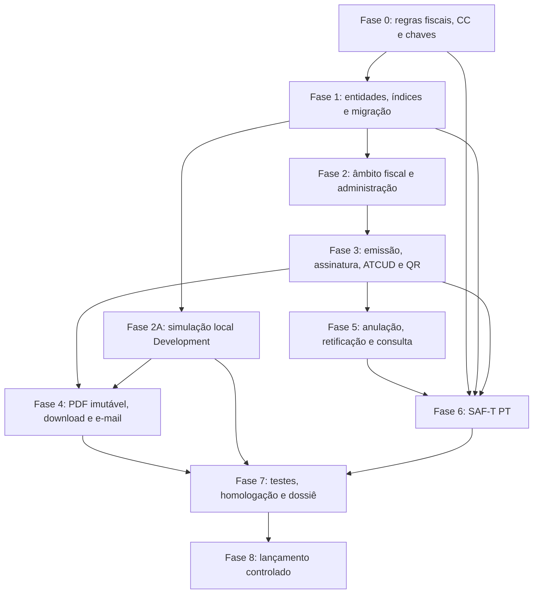

# Plano de implementação — ATCUD, código QR, SAF-T (PT) e certificação AT

## Resultado pretendido

Implementar a emissão fiscal de recibos de donativos com ATCUD, código QR, assinatura fiscal, PDF imutável, anulação e retificação auditáveis e exportação SAF-T (PT). O sistema suportará `SingleInvoiceTable` (emitente no âmbito do tenant) e `MultipleTablesPerFoodBank` (emitente e séries por `FoodBank`).

Em paralelo, disponibilizar exclusivamente em `Development` um percurso local de
simulação. Este permite testar no browser a emissão, consulta, download e
reimpressão sem AT, série AT, certificado de software ou Azure Key Vault, mas produz
um artefacto inequivocamente não fiscal e persistido fora do agregado fiscal real.

Um pagamento elegível origina exatamente um documento fiscal original, inclusive perante reenvio de webhook, e-mail ou download. Recibos históricos permanecem disponíveis, mas não são reinterpretados como documentos fiscais.

## Decisões que guiam o trabalho

| Tema | Decisão |
| --- | --- |
| Branch histórica | Não reutilizar a branch `feature/734-update-invoices-for-new-tax-law` nem a migração que remove `Donations.Referral`. |
| `TaxRegistrationNumber` | Preservar o conceito no novo `FiscalIssuerProfile`, na base de dados de aplicação do tenant. |
| `SoftwareCertificateNumber` | Configurar no perfil fiscal, com vigência, e copiar para o documento emitido. |
| `HashCypher` | Não introduzir. Nunca persistir chaves privadas, segredos ou palavras-passe na base de dados. |
| `ATCUD` | Persistir apenas no documento fiscal final; não tratar como configuração fixa do tenant ou do Banco Alimentar. |
| Recibos antigos | `Invoice` mantém o papel de recibo legado. O novo agregado `FiscalDocument` trata documentos fiscais. |
| Assinatura | Usar uma chave RSA não exportável no Azure Key Vault/HSM; guardar identificador, versão, hash, controlo de hash e encadeamento aplicável. |
| PDF | Persistir o PDF fiscal e respetivo checksum no blob. Reimpressões descarregam o mesmo ficheiro. |
| Simulação local | É um fluxo e um conjunto de tabelas próprios, só ativáveis com `Fiscal:Simulation:Enabled=true` no ambiente exatamente `Development`; não é uma flag editável em `FiscalDocument`. |
| Artefactos de simulação | Usar identificador `SIM-...`, checksum local, QR privado `AEI-SIM/v1`, prefixo de blob separado e nome de ficheiro `SIMULACAO-...`; não criar nem apresentar ATCUD, assinatura, certificado ou SAF-T. |

## Registo de estado

| Data | Trabalho | Estado | Nota |
| --- | --- | --- | --- |
| 2026-09-19 | Fase 1 — Modelo fiscal, entidades e migração segura | Em revisão — correções | A fundação foi revista; faltam regras de coerência entre série e emitente, âmbito persistido, e integridade de originais e retificações. |
| 2026-09-19 | TDD da Fase 1 — testes do modelo fiscal e da migração | Em revisão — correções | Os contratos de metadados existem; faltam testes relacionais posteriores para validar a migração e as restrições na base de dados. |
| 2026-09-20 | Fase 2A — Simulação fiscal local | Planeada | Requisito de desenvolvimento separado da emissão fiscal real; a arquitetura foi aprovada antes da implementação. |

## Pré-condições para produção

O Contabilista Certificado (CC) e a operação têm de aprovar, por emitente:

1. O tipo de documento SAF-T, a tributação ou isenção, e as regras de anulação e retificação.
2. Nome legal, NIF, morada, identificação do doador e data de ativação fiscal.
3. Cada série comunicada à AT: tipo documental, processamento, início, código de validação, e evidência da comunicação.
4. O certificado de software da versão de produção e a referência de chave RSA no Azure Key Vault/HSM.
5. A versão do XSD SAF-T (PT), exemplos de homologação, e o procedimento Modelo 24.

Estes requisitos bloqueiam somente a ativação em produção. Não bloqueiam a implementação, os testes, a configuração em rascunho, nem séries AT de teste fora de produção.

## Fases de entrega

### Fase 0 — Consolidar regras fiscais e dados de ativação

**Dependências:** nenhuma. **Estimativa:** 2–4 dias, dependente do CC e da entidade produtora do software.

- Criar a matriz de decisão por tenant e, quando necessário, por `FoodBank`: âmbito, tipo SAF-T, série, IVA/isencão, identificação do doador, retificação e data de corte.
- Validar a cadeia de assinatura e o payload QR contra a especificação AT em vigor.
- Definir o procedimento de comunicação e fecho de séries. Esta entrega regista e audita o código AT; não comunica séries automaticamente.
- Criar o procedimento para chaves de homologação e produção, permissões de assinatura, rotação, chave pública e evidência para Modelo 24.

**Conclusão:** matriz aprovada pelo CC e configuração de homologação completa para pelo menos um emitente de teste.

### Fase 1 — Modelo fiscal, entidades e migração segura

**Dependência:** Fase 0 para códigos e regras definitivas. **Estimativa:** 4–6 dias.

- Criar no projeto `BancoAlimentar.AlimentaEstaIdeia.Model`:
  - `FiscalIssuerProfile`, com o âmbito opcional `FoodBankId`, NIF, certificado, dados legais, regras fiscais, chave e vigência;
  - `FiscalDocumentSeries`, com código, método, número inicial/próximo/final, validação AT, estado e `RowVersion`;
  - `FiscalDocument`, com relação à doação, série, emitente, documento original, data, identificador, ATCUD, hashes, QR, snapshots fiscais, totais, estado e PDF;
  - `FiscalDocumentLine`, `FiscalDocumentEvent` e `FiscalAuditEvent` append-only.
- Atualizar `ApplicationDbContext` com tipos, precisão monetária, limites, relações restritas e índices únicos para série/número, ATCUD, linha e original por doação.
- Criar uma migração nova em `BancoAlimentar.AlimentaEstaIdeia.Web/Migrations/`, sem modificar, apagar, preencher ou renumerar `Invoices` e sem alterar `Donations.Referral`.
- Criar enums explícitos: `FiscalDocumentStatus`, `FiscalDocumentKind`, `FiscalSeriesStatus`, `FiscalProcessingMethod` e `FiscalScopeKind`.
- Garantir a coerência relacional entre `FiscalDocument`, `FiscalDocumentSeries` e `FiscalIssuerProfile`: uma série usada pelo documento tem de pertencer ao emitente persistido no mesmo documento. Implementar com chave e relação compostas, ou uma restrição equivalente verificável na base de dados.
- Persistir no `FiscalDocument` o âmbito resolvido da emissão — estratégia e `FoodBankId` opcional — e validar a coerência com o perfil e a doação. Em `SingleInvoiceTable`, o `FoodBankId` fica vazio; em `MultipleTablesPerFoodBank`, é obrigatório e coincide com o Banco Alimentar da doação.
- Reforçar a regra de original, retificação e crédito: apenas `Original` pode não ter documento original; `Correction` e `Credit` exigem essa referência. A unicidade de original por doação tem de usar o tipo documental, não apenas a ausência da referência.
- Como trabalho pendente obrigatório da Fase 1, criar testes relacionais para aplicar a migração sobre uma base com `Invoices` históricos e comprovar as regras de `Kind`/`OriginalFiscalDocumentId`, o âmbito imutável `InvoicingStrategy`/`FoodBankId`, a coerência série–emitente, FKs restritivas e índices únicos. Não usar EF InMemory para estas verificações.

**Conclusão:** depois dos testes relacionais pendentes, a migração aplica-se sem tocar em recibos antigos e impede duplicações fiscais por restrições relacionais.

### Fase 2 — Âmbito fiscal e administração

**Dependência:** Fase 1. **Estimativa:** 4–6 dias.

- Implementar `IFiscalScopeResolver` no repositório. Em `SingleInvoiceTable`, resolve o perfil do tenant; em `MultipleTablesPerFoodBank`, exige a resolução pelo `FoodBank` da doação.
- Bloquear emissão antes de reservar numeração quando faltar emitente válido, série ativa, código AT, certificado, chave ou configuração fiscal.
- Criar as áreas administrativas `Areas/Admin/Pages/Fiscal/` para emitentes, séries, documentos e SAF-T, com view models específicos.
- Limitar as ações administrativas, anulações, retificações e exportações a utilizadores autorizados para o tenant e âmbito de `FoodBank`.
- Auditar criação, alteração, aprovação, ativação, fecho e tentativas bloqueadas.

**Conclusão:** emitentes e séries de dois Bancos Alimentares no mesmo tenant ficam segregados e administráveis.

### Fase 2A — Simulação fiscal local, estritamente em Development

**Dependências:** Fase 1; a integração de browser depende também do percurso de
download da Fase 4. **Estimativa:** 5–8 dias. Esta fase não depende de configuração
AT, perfis de emitente, séries comunicadas, certificado de software, Key Vault ou
homologação AT.

#### 2A.1 — Testes de caracterização e fronteira de segurança (primeiro)

- Criar em `BancoAlimentar.AlimentaEstaIdeia.Repository.Tests/` as suites
  `FiscalSimulationModeTddTests.cs`, `SimulatedFiscalDocumentTddTests.cs`,
  `SimulatedFiscalIssuanceTddTests.cs`, `SimulatedReceiptArtifactTddTests.cs` e,
  quando a cobertura precisar do anfitrião web,
  `BancoAlimentar.AlimentaEstaldeia.Web.IntegrationTests/IntegrationTests/FiscalSimulationTests.cs`.
- Escrever primeiro testes unitários para `Fiscal:Simulation:Enabled` ausente,
  `false`, e `true`; `true` só resolve `Simulation` quando
  `IHostEnvironment.EnvironmentName` é exatamente `Development`. Cobrir
  explicitamente `Testing`, `Staging`, `PreProduction`, `Production` e um nome
  desconhecido: todos têm de falhar no arranque antes de o DI poder resolver o fluxo
  simulado.
- Caracterizar o percurso fiscal atual com simulação desligada: continua a exigir
  perfil, série, código AT, assinatura e as proteções de `FiscalEnvironmentGate`.
  Não aceitar fallback entre os dois percursos.
- Criar testes relacionais com a infraestrutura SQL Server existente para as chaves
  únicas `DonationId` e `ScopeKey + Sequence`, concorrência/`rowversion`, FKs
  restritivas e imutabilidade. EF InMemory não é evidência suficiente.

**Conclusão:** há testes vermelhos que definem a ativação *fail closed*, a separação
semântica e a emissão idempotente antes de se criar o modo.

#### 2A.2 — Modelo persistente separado e migração

- Criar em `BancoAlimentar.AlimentaEstaIdeia.Model/` os tipos
  `SimulatedFiscalDocument`, `SimulatedFiscalSequence` e
  `SimulatedFiscalAuditEvent` (ou um diário imutável equivalente com
  `IssuanceMode = Simulation`). Os tipos transportam apenas: doação/pagamento,
  estratégia, `FoodBankId` quando aplicável, `ScopeKey`, sequência, identificador
  sintético, fotografia mínima de demonstração, checksum de simulação, payload e PNG
  QR privados, referência do artefacto, ambiente de origem, criação e auditoria.
- Não adicionar aos tipos simulados as propriedades ou nomes fiscais `Atcud`,
  `AtValidationCode`, `FiscalHash`, `HashControl`,
  `SoftwareCertificateNumber`, `SigningKeyVersion` ou
  `AtCommunicationReference`. O modelo não pode oferecer uma conversão para
  `FiscalDocument`.
- Atualizar `BancoAlimentar.AlimentaEstaIdeia.Model/ApplicationDbContext.cs` com
  `DbSet`s, limites, precisão monetária, relações restritas, verificação de
  `InvoicingStrategy`/`FoodBankId`, índice único em `DonationId`, índice único em
  `ScopeKey + Sequence` e `RowVersion` no contador. Rejeitar alterações a dados
  simulados após a emissão, exceto a gravação única e idempotente da referência do
  artefacto antes da sua publicação.
- Criar uma migração aditiva em
  `BancoAlimentar.AlimentaEstaIdeia.Web/Migrations/` e atualizar
  `ApplicationDbContextModelSnapshot.cs`. A migração não pode alterar `Invoices`,
  preencher séries reais, criar ATCUDs, nem mover dados entre as novas tabelas e
  `FiscalDocuments`.
- Repetir os testes de modelo/migração contra uma base com recibos históricos e
  demonstrar que os novos índices não interferem com documentos fiscais ou legados.

**Conclusão:** uma simulação é impossível de promover por edição de uma flag, e o seu
contador não toca numa `FiscalDocumentSeries` real.

#### 2A.3 — Composição segura e dois percursos de emissão

- Criar no repositório `FiscalSimulationOptions`, `FiscalIssuanceMode` e
  `IFiscalIssuanceModeResolver`, com uma implementação que só recebe
  `IHostEnvironment` e `IOptions<FiscalSimulationOptions>`. A opção é ligada uma
  única vez a partir da configuração de processo em `Startup.cs`, antes da troca para
  `TenantConfigurationRoot`; nunca é lida de configuração do tenant, de HTTP, de
  cookie ou de uma página Admin.
- Em `BancoAlimentar.AlimentaEstaIdeia.Web/Startup.cs`, validar a opção durante o
  arranque. Uma opção ativa fora de `Development` lança uma exceção acionável e não
  regista implementações de simulação. A configuração entregue no repositório fica
  desligada; a ativação local é documentada, mas não se guarda uma definição ativa
  em `appsettings.*` partilhado, pipelines ou slots.
- Extrair o código atual de
  `BancoAlimentar.AlimentaEstaIdeia.Repository/FiscalDocumentIssuanceService.cs`
  para um percurso real explícito e introduzir um orquestrador do contrato
  `IFiscalDocumentIssuanceService`. Evoluir o respetivo resultado para uma referência
  de recibo neutra, obrigatoriamente discriminada por `Real` ou `Simulation`, em vez
  de devolver um `FiscalDocument` e obrigar a representar uma simulação como fiscal.
  Atualizar os consumidores e testes desse contrato no mesmo passo.
- Criar `SimulatedFiscalDocumentIssuanceWorkflow`,
  `ISimulatedFiscalIdentifierAllocator`, `ISimulationChecksumService` e
  `ISimulatedReceiptQrPayloadBuilder`. O fluxo valida a doação paga, autorização e
  tenant confiável antes de resolver o âmbito operacional; em
  `SingleInvoiceTable` usa chave por tenant e em
  `MultipleTablesPerFoodBank` usa tenant + `FoodBankId` da doação. Não chama
  `IFiscalScopeResolver` no ponto que exige perfil/série AT; extrair desse resolvedor
  uma resolução operacional comum ou um contrato distinto que preserve a validação
  da doação e do `FoodBank`.
- Reservar o contador em transação SQL, com repetição limitada em colisão. A segunda
  chamada para a mesma doação devolve o mesmo `SimulatedFiscalDocument`; doações
  diferentes reservam sequências distintas dentro do mesmo âmbito. Construir apenas
  `SIM-<scope>-<sequence>`, checksum de simulação e payload `AEI-SIM/v1`; não invocar
  Key Vault, `IFiscalSignatureService`, `IFiscalQrPayloadBuilder`,
  `IFiscalEnvironmentGate` para requisitos de série, ou qualquer cliente da AT.
- Registar a emissão e recusas em auditoria com modo, ambiente `Development`, tenant,
  âmbito, utilizador, correlação e motivo `DevelopmentSimulation`, sem segredos nem
  dados pessoais desnecessários.

**Conclusão:** o servidor seleciona inequivocamente um percurso; a simulação conserva
autorização, elegibilidade, isolamento, idempotência e concorrência, sem enfraquecer
a emissão real.

#### 2A.4 — PDF, QR, blob e entrega no browser

- Criar contratos próprios `ISimulatedReceiptPdfRenderer` e
  `ISimulatedReceiptArtifactDeliveryService`, mais modelos de visualização sem campos
  fiscais. Implementar os adaptadores web em
  `BancoAlimentar.AlimentaEstaIdeia.Web/Services/Invoices/` e uma vista Razor própria
  em `BancoAlimentar.AlimentaEstaIdeia.Web/Areas/Admin/Pages/Fiscal/` ou em
  `Areas/Identity/Pages/Account/Manage/Invoices/`, consoante a convenção de
  renderização escolhida.
- A vista HTML, o PDF de todas as páginas e o texto de entrega incluem a expressão
  exata `SIMULAÇÃO — SEM VALIDADE FISCAL`. O renderer aplica a marca a cada
  `PdfPage`, não apenas à primeira, e mostra o identificador sintético com rótulo
  próprio, nunca `ATCUD`.
- Manter os artefactos simulados num prefixo de blob separado, por exemplo
  `simulation/development/<tenant>/<scope>/`, com metadados
  `issuance-mode=simulation` e `origin-environment=Development`. O adaptador fiscal
  atual em `FiscalReceiptPdfBlobStore.cs` e o serviço fiscal em
  `FiscalReceiptDeliveryService.cs` devem recusar esse prefixo; o adaptador simulado
  recusa ler/blobs fora dele.
- Adaptar
  `BancoAlimentar.AlimentaEstaIdeia.Web/Areas/Identity/Pages/Account/Manage/GenerateInvoice.cshtml.cs`
  para consumir o resultado discriminado: conserva autorização/tokens de doação e
  entrega o artefacto já persistido. Para simulação, definir
  `Content-Disposition` e nome `SIMULACAO-<identificador>.pdf`, adicionar metadados
  de resposta de simulação e nunca usar a entrega fiscal. Atualizar o caminho de
  e-mail/link que partilha a emissão para transportar o mesmo discriminador.
- Criar testes que descodificam o QR e provam que começa com o protocolo privado e
  não com a gramática QR da Portaria n.º 195/2020; extraem todas as páginas do PDF,
  verificam a marca e confirmam prefixo/metadados/nome de download. A reimpressão
  devolve os mesmos bytes e não consome sequência.

**Conclusão:** o utilizador de desenvolvimento consegue completar o percurso normal
no browser sem Azure Key Vault ou AT, recebendo apenas um artefacto não fiscal e
inequivocamente marcado.

#### 2A.5 — Consulta administrativa e exclusões fiscais

- Criar uma página de consulta apenas de leitura em
  `BancoAlimentar.AlimentaEstaIdeia.Web/Areas/Admin/Pages/Fiscal/Simulations.cshtml`
  e `Simulations.cshtml.cs`, com recursos PT/EN em `Resources/Areas/Admin/Pages/Fiscal/`.
  A página aparece na navegação apenas quando o resolvedor do servidor confirma
  `Development` + simulação ativa; não contém controlo de ativação e conserva as
  políticas de função e o filtro de tenant/`FoodBank`.
- A consulta mostra modo, ambiente, identificador sintético, doação, âmbito,
  sequência, estado, checksum de simulação, artefacto e auditoria. Não oferece
  pesquisa por ATCUD, exportação, anulação, retificação ou ação de promoção. Se se
  optar por integrar a listagem existente `Documents.cshtml`, fazê-lo apenas por uma
  projeção explicitamente discriminada e com as mesmas recusas de ação.
- Reforçar `FiscalAdministrationService`, `IFiscalDocumentQueryService`, os serviços
  de anulação/retificação e os handlers Admin para aceitar exclusivamente IDs de
  `FiscalDocument` nos fluxos reais. A exportação SAF-T continua a consultar só
  `FiscalDocument` e linhas fiscais; nenhum repositório, migração ou administrador
  pode converter ou incluir uma tabela simulada.
- Criar testes de autorização e segregação: outro tenant, outro `FoodBank` e um
  utilizador sem a função adequada não consultam nem descarregam a simulação. Criar
  testes de regressão que recusam uma simulação em anulação, correção, download
  fiscal e SAF-T.

**Conclusão:** as simulações são rastreáveis para desenvolvimento, mas permanecem
isoladas de todas as operações e evidências fiscais.

#### 2A.6 — Validação de integração e operação local

- Executar o cenário web em `Development` com a configuração ativa e uma doação de
  teste paga/elegível: emissão, download, segundo download/reimpressão, consulta
  Admin e tentativa de operações fiscais proibidas. Repetir para
  `SingleInvoiceTable` e `MultipleTablesPerFoodBank` com dois Bancos Alimentares.
- Executar os mesmos testes de composição com a configuração ativa para cada ambiente
  proibido e confirmar falha no arranque. Em `Development` com a opção ausente ou
  `false`, confirmar que o fluxo real continua a bloquear sem perfil/série/chave.
- Validar que não foram introduzidos valores de teste em slots, pipelines, ficheiros
  de configuração partilhados ou segredos. Documentar apenas a chave local e o
  procedimento de ativação/desativação para programadores.

**Conclusão:** os critérios de aceitação 13–18 ficam cobertos por testes automatizados
e por um percurso manual repetível, sem alegar homologação ou validade AT.

### Fase 3 — Emissão, assinatura, ATCUD e QR transacionais

**Dependências:** Fases 0–2. **Estimativa:** 7–10 dias.

- Criar `IFiscalDocumentIssuanceService`, `IFiscalSignatureService`, `IFiscalSigningKeyProvider`, `IFiscalQrPayloadBuilder`, serviços de consulta, cancelamento, correção e auditoria.
- Integrar Azure Key Vault através da configuração já existente, usando RSA não exportável e nunca registando material privado.
- Construir a assinatura canónica e guardar `PreviousHash`, `Hash`, `HashControl` e versão da chave. Validar com chave pública de teste.
- Construir o payload QR a partir do snapshot fiscal final, persistir o texto antes da imagem e usar o `QRCoder` existente apenas para gerar o PNG.
- Implementar emissão idempotente: verificar a doação, pagamento e corte histórico; resolver o âmbito; devolver o original existente; e reservar o número por atualização SQL atómica ou repetição limitada com `rowversion`.
- Criar numa transação única documento, linhas, snapshot, ATCUD (`<código validação>-<sequencial>`), assinatura, QR e auditoria. Não usar `Max`, `lock (this)`, cache ou numeração anual.
- Manter `InvoiceRepository` apenas no caminho legado e criar uma consulta agregada de históricos e documentos fiscais.

**Conclusão:** emissões concorrentes têm numeração e ATCUD únicos, e cada repetição devolve o mesmo documento.

### Fase 4 — PDF fiscal imutável, download e e-mail

**Dependência:** Fase 3. **Estimativa:** 5–7 dias.

- Criar `IFiscalPdfRenderer` e modelo de renderização baseado somente no snapshot do documento.
- Introduzir `FiscalReceiptPageModel` ou equivalente dedicado na área de faturas, mantendo o percurso dos recibos históricos.
- Adaptar os templates atuais para apresentar identificação legal, doador aplicável, tipo/série/número/data, linhas, totais, isenção/IVA, ATCUD, QR, hash e certificado.
- Atualizar `GenerateInvoice.cshtml.cs`: criar e guardar o PDF final só na primeira emissão, persistir checksum, e recuperar com o snapshot/versionamento de template após falha.
- Criar token de download fiscal com tenant e âmbito; manter compatibilidade temporária para tokens históricos.
- Atualizar e-mail, webhook e pedidos posteriores para usar o serviço fiscal idempotente.

**Conclusão:** download, e-mail e reimpressão devolvem o mesmo blob; QR descodificado coincide com o payload persistido.

### Fase 5 — Anulação, retificação, consulta e auditoria

**Dependências:** Fases 2–4. **Estimativa:** 4–6 dias.

- Implementar transições fiscais explícitas (`Issued`, `Cancelled`, `Corrected`, e estados aprovados pelo CC).
- Separar `CancelInvoice` legado do cancelamento fiscal. O original fiscal conserva número, ATCUD, assinatura, QR, linhas, snapshot e PDF.
- Criar retificações como novos documentos ligados ao original, sempre com nova série/número/ATCUD/assinatura/QR.
- Criar pesquisa administrativa por emitente, série, número, ATCUD, doação, período e estado.
- Registar eventos para descargas, reimpressões, anulações, retificações e falhas, sem segredos nem payloads pessoais completos.

**Conclusão:** anulações e retificações são rastreáveis, preservam o original, e nunca reutilizam identificadores fiscais.

### Fase 6 — Exportação SAF-T (PT)

**Dependências:** Fases 0, 1, 3 e 5. **Estimativa:** 5–7 dias.

- Criar `ISaftExportService` e um gerador XML versionado que consulta apenas snapshots de `FiscalDocument` e linhas fiscais.
- Mapear emitente, clientes/doadores, produtos/serviços, documentos, linhas, impostos, isenções, totais, anulações e retificações para o XSD aprovado.
- Ordenar deterministamente, guardar versão XSD/checksum e auditar o pedido, emitente, período, ator e resultado.
- Criar página administrativa que exige emitente e período explícitos, verifica âmbito e devolve XML com nome identificável.
- Versionar o XSD oficial para validação automatizada de exportações.

**Conclusão:** cada exportação por emitente e período valida no XSD aprovado e não apresenta recibos legados como certificados.

### Fase 7 — Testes, homologação e evidências de certificação

**Dependências:** Fases 1–6. **Estimativa:** 6–9 dias.

- Adicionar testes de emissão, âmbito, assinatura, QR, cancelamento, correção e SAF-T no projeto `BancoAlimentar.AlimentaEstaIdeia.Repository.Tests`.
- Executar testes de integração relacionais, sem EF InMemory, para concorrência, `rowversion`, índices filtrados, transações e restrições únicas.
- Incluir uma suite relacional posterior para aplicar a migração fiscal sobre uma base com `Invoices` históricos e validar: coerência série–emitente, âmbito `FoodBank`, restrições de original/retificação, FKs restritivas e índices únicos. Esta suite não substitui os contratos TDD de metadados da Fase 1.
- Testar QR contra exemplos AT, gerar PNG e descodificá-lo; testar igualdade entre QR, PDF e campos persistidos.
- Testar a imutabilidade do PDF depois de alterar doador, `FoodBank` ou configuração; preservar a disponibilidade de recibos históricos.
- Testar autorização e isolamento entre tenants e Bancos Alimentares.
- Executar a matriz da Fase 2A: ativação *fail closed*, emissão browser em
  `Development`, idempotência/concorrência simulada, QR/PDF/metadados, consulta
  segregada e exclusão de SAF-T/anulação/retificação. Estes testes não são prova de
  conformidade AT e não substituem homologação no webservice da AT.
- Executar os comandos de build e testes definidos no `AGENTS.md` e preparar o dossiê com release, chave pública, QR, assinatura, SAF-T, resultados de teste, procedimento de séries, e limitações validadas pelo CC.

**Conclusão:** cada critério de aceitação tem teste automatizado ou evidência de homologação e o dossiê suporta a submissão Modelo 24.

### Fase 8 — Lançamento controlado

**Dependências:** Fase 7 e aprovação do CC. **Estimativa:** 2–4 dias, excluindo o prazo da AT.

- Aplicar migrações em preprodução e confirmar que `Invoices` históricos não mudaram.
- Configurar séries de teste fora de produção e executar o fluxo completo de pagamento, emissão, QR, download, e-mail, anulação, retificação e SAF-T.
- Submeter a versão candidata pelo Modelo 24 e responder a pedidos de conformidade da AT.
- Depois do certificado, configurar produção e ativar um emitente de cada vez, na data fiscal aprovada.

**Conclusão:** a primeira emissão de produção usa série AT válida, inclui o certificado atribuído e produz evidência integral de auditoria.

## Dependências

## Critérios de conclusão

1. Cada donativo pago elegível recebe série, sequência, ATCUD, assinatura, QR, certificado e PDF persistido.
2. A configuração fiscal incompleta bloqueia a emissão antes de reservar numeração.
3. Webhook, e-mail e download repetidos não criam outro documento.
4. Séries concorrentes conservam unicidade e encadeamento correto.
5. As duas estratégias segregam emitente, séries, ATCUD, documentos e SAF-T.
6. Recibos históricos permanecem acessíveis e inalterados.
7. Anulações e retificações preservam o original e são auditáveis.
8. O SAF-T usa snapshots imutáveis, é filtrado por emitente e período, e valida no XSD aprovado.
9. O QR descodifica para os mesmos dados fiscais do documento.
10. A release inclui testes e evidências técnicas para a candidatura de certificação.
11. Com `Fiscal:Simulation:Enabled=true` apenas em `Development`, uma doação de teste
    pode ser emitida, descarregada, reimpressa e consultada sem AT, Key Vault, perfil
    ou série reais; a mesma doação nunca cria nova sequência.
12. Cada simulação usa tabelas, contador, QR, checksum, PDF, prefixo de blob e nome de
    download próprios; apresenta `SIMULAÇÃO — SEM VALIDADE FISCAL` em todas as páginas
    e não tem nem apresenta quaisquer dados fiscais.
13. A opção de simulação ativa impede o arranque em qualquer ambiente que não seja
    exatamente `Development`; documentos simulados não entram em SAF-T, anulação,
    retificação ou entrega fiscal e não são promovíveis.
